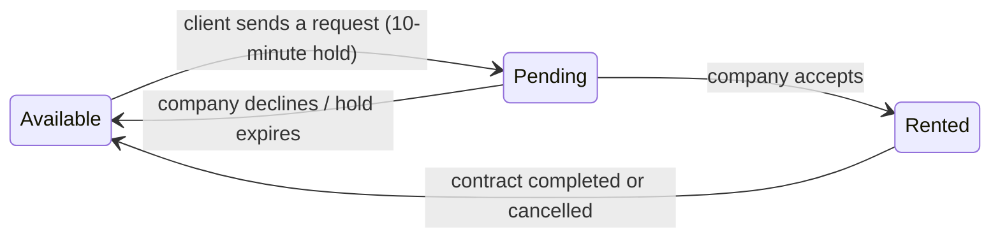
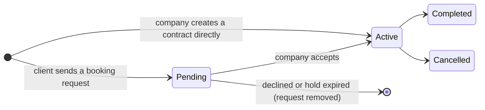

# FleetDrive — Rent-a-Car Web Platform

## Project goal 🎯
FleetDrive is a web application that helps rent-a-car businesses manage their fleet and contract data. It also has a client side, where users can browse rental companies, send a booking request for a vehicle, and follow the request by email until the company accepts or declines it.

The project's goal is to show the contributor's skills and knowledge of the ASP.NET Core and Entity Framework Core frameworks. **Everything listed as implemented in this project is claimed as theoretically understood by the contributor.**

---

## Features ✨

**Company side** (`Company` role)
- Dashboard with incoming booking requests, which the company can accept or decline with an optional reply (remarks)
- Fleet manager for adding vehicles, using dropdowns for make, model and type that come from seeded lookup tables
- Fleet overview with vehicle deletion (only the company's own vehicles)
- Contract creator for walk-in rentals, and a contract history where active contracts are marked *Completed* or *Cancelled*
- Statistics dashboard (Chart.js): fleet utilization over time, revenue by vehicle type, most popular vehicles and average rental duration

**Client side** (`Client` role)
- List of partner companies and their available vehicles
- Booking request form with driver details. The total price is calculated on the server.
- Email updates when a request is sent, accepted or declined
- A vehicle recommender page *(the matching algorithm is being reworked, see [Known limitations](#known-limitations-))*

**Accounts**
- Sign up as a client or a company, with email verification before the first login
- Login and logout using a signed authentication cookie
- Resend the verification email, and reset a forgotten password through a single-use emailed link

---

## Technologies 🛠
* **Backend**
  - C#, ASP.NET Core 8 (MVC), Entity Framework Core 8, Cookie authentication, MailKit (SMTP)
* **Database**
  - Local SQLite database
* **Frontend**
  - Bootstrap 5, HTML5, CSS3, JavaScript, Razor views, Chart.js
* **IDE & tools**
  - Visual Studio Community, DB Browser for SQLite, Obsidian (notes)
* **AI assistants**
  - Claude AI, Gemini AI, Cursor AI


---

## Database Architecture 📘
The application uses a relational database built around four core entities linked by foreign keys:
1. **Vehicles**: fleet details, linked to the company that owns each vehicle, with a `Version` GUID used for concurrency control
2. **Contracts**: rental agreements that link clients to specific vehicles, with rental periods, driver details, status and total price
3. **Clients**: accounts for users who book vehicles, including email verification and password reset fields
4. **Companies**: accounts and ownership for fleets, with the same verification and reset fields

**Lookup entities** (`VehicleMake`, `VehicleModel`, `VehicleType`) are **seed data** inserted through migrations (12 makes, their models and 8 vehicle types) and shared by every vehicle.

**Unique indexes** at database level protect usernames, emails and vehicle registration numbers.

The schema is managed code-first through **7 EF Core migrations**:

| Migration | What it added |
|---|---|
| `PipelineRepiar14102026` | Base schema and lookup seed data |
| `AddTotalPriceToContract` | Server-calculated total price on contracts |
| `UniqueUsername` | Unique index on usernames |
| `UniqueRegistrationNumber` | Unique index on vehicle registration numbers |
| `AddVehicleVersion` | `Version` GUID concurrency token on `Vehicle` |
| `AddEmailVerification` | Email, verification token hash and expiry, unique email index |
| `AddPasswordReset` | Reset token hash and expiry |

---

## Application Structure 📕
```
RentACarPortal/
├── Controllers/   One controller per feature, protected with [Authorize(Roles = ...)]
├── Services/      Business logic and LINQ queries (service layer)
│   ├── BookingManager, DashboardService, FleetService, StatisticsService
│   ├── NotificationManager       builds the six HTML emails
│   ├── IEmailSender / GmailEmailSender   SMTP behind an interface
│   ├── PasswordService           PBKDF2 password hashing
│   ├── TokenService              random tokens + SHA-256 hashing
│   └── ContractEmailData         immutable snapshot (record) used for emails
├── Models/        Entities, lookup models and StatusNames (named status constants)
├── Data/          AppDbContext (Fluent API, unique indexes) and seed classes
├── Migrations/    EF Core code-first migrations
├── Views/         Razor views, one folder per controller (Views/<Controller>/<Action>.cshtml)
└── Program.cs     DI registrations, cookie authentication and the middleware pipeline
```

### Booking lifecycle
**Vehicle status**


**Contract status**


Each change is checked on the server. For example, only an `Active` contract can be moved to `Completed` or `Cancelled`, and only a `Pending` request can be accepted or declined. Each status change gives the vehicle a new `Version` GUID.

---

## Getting started 🚀
**Requirements:** .NET 8 SDK (or Visual Studio 2022 with the ASP.NET workload), and a Gmail account with 2-Step Verification and an App Password if you want emails to be sent.

```bash
git clone https://github.com/muhamedmujanovicb/RentACarPortal.git
cd RentACarPortal/RentACarPortal

# trust the local HTTPS certificate (the auth cookie is HTTPS-only)
dotnet dev-certs https --trust

# email credentials are kept in user-secrets, never in appsettings.json
dotnet user-secrets set "Email:Address" "your.address@gmail.com"
dotnet user-secrets set "Email:AppPassword" "your-app-password"

dotnet run
```
The SQLite database (`fleetdrive.db`) is created and migrated automatically on startup (`Database.Migrate()`), including the seed data. Sign up, open the verification link from your inbox, and log in.

---

## Key Modules 🗝
* **Authentication and Authorization**
  - Cookie authentication with claims (id, username and role), salted PBKDF2 password hashing, email verification before login, a database re-check of the cookie on every request, role-based access for the Company and Client sides, ownership checks on every company-owned record, and anti-forgery validation on every POST request
* **Fleet & Contract Services**
  - The service layer handles data flow, validation, and relational integrity between vehicle registrations and client contracts
* **Email Notifications**
  - Six HTML emails (verification, password reset, request sent, new request, accepted, declined), sent over TLS-encrypted SMTP only after the database save succeeds, with all user text HTML-encoded
* **Interactive Statistics Dashboard**
  - Aggregates contract data with LINQ grouping and joins and renders it with Chart.js: fleet utilization, revenue by vehicle type, rental popularity and average rental duration
* **Booking System**
  - Lets a client send a booking request through a validated form pipeline. A vehicle is held while its request is pending, can only be booked while it is available, and is protected against double booking by optimistic concurrency.

---

## Learning outcomes 🧠
This project was a practical exercise in moving past theory and building core backend patterns firsthand. Each concept below is implemented in the code and understood by the contributor.

### SECTION 1 — Architecture Foundations
* **Monolithic application**
  - One deployable ASP.NET Core app that contains the UI, business logic, data access and a single database. This is simple to build, run and debug at this scale.
* **MVC model**
  - Controllers handle HTTP requests, Models define the data, and Razor Views render it. There is one controller and one view folder per feature, and routing uses the convention `{controller}/{action}/{id?}`.
* **Migrations in EF Core**
  - The schema evolves code-first through migrations (see the table above), including unique indexes and seed data, and is applied automatically on startup.
* **Service layer**
  - Controllers stay thin and call services (`BookingManager`, `DashboardService`, `FleetService`, `StatisticsService`, `NotificationManager`), which hold the business rules and queries.
* **Enterprise-style patterns at small scale**
  - Dependency injection, an interface abstraction for email, immutable snapshot records (`ContractEmailData`), DTOs for chart data (`StatisticsDataDto`), named constants and configuration through user-secrets, all applied to a small app.

### SECTION 2 — Auth & Security
* **Sync and async operations**
  - `async`/`await` is used where the work waits on I/O and the framework offers it: sign-in and sign-out, SMTP sending, statistics and fleet queries. Simple EF queries stay synchronous.
* **Password hasher**
  - Passwords go through ASP.NET Core's `PasswordHasher<T>` (wrapped in `PasswordService`) and are never stored or compared in plain text.
* **Salted hash**
  - Every password gets its own random salt, so two equal passwords produce different hashes and precomputed tables are useless.
* **Authentication**
  - Answers the question *who are you?* A correct username and password produce a signed authentication cookie, and identity always comes from that cookie, never from form fields.
* **Authorization**
  - Answers the question *what are you allowed to do?* This is done with `[Authorize(Roles = "Company")]` / `[Authorize(Roles = "Client")]` on controllers, plus ownership checks in the services.
* **Claims (claims-based identity, ClaimsPrincipal)**
  - At login a `ClaimsIdentity` with `NameIdentifier` (id), `Name` (username) and `Role` claims is wrapped in a `ClaimsPrincipal`. Controllers read `User.Identity.Name`.
* **Cookie authentication**
  - `AddAuthentication().AddCookie(...)` with a login path, an access-denied path and hardened cookie options (see Section 5).
* **ASP.NET Core middleware pipeline: order of `UseAuthentication` and `UseAuthorization`**
  - At login, the principal and its claims are serialized, encrypted and signed, then packed into a cookie.
  - On each request, the authentication middleware decrypts the cookie and rebuilds the principal, and `OnValidatePrincipal` re-checks the account in the database. That sets the user and role *before* the authorization middleware evaluates `[Authorize]`, and only then does the controller run.
  - That is why `UseAuthentication()` must come before `UseAuthorization()`, and both come after `UseRouting()`.
* **Broken access control**
  - The #1 OWASP web risk: users acting outside their intended permissions. It is handled at two levels, described next.
* **Vertical broken access control**
  - A lower role doing a higher role's actions, for example a client opening company pages. It is prevented by **role-based authorization**: every company controller requires the `Company` role, and every client controller requires the `Client` role.
* **Horizontal broken access control (IDOR, Insecure Direct Object Reference)**
  - The correct role but someone else's data, for example a company changing `?id=` to open another company's contract. It is prevented by **ownership checks (object-level authorization)**: queries are scoped to the logged-in company (`ContractsOwnedBy(companyId)`, `v.CompanyId == company.Id`), so another company's record is simply never found.
* **Ownership check (object-level authorization) to prevent IDOR**
  - Applied to viewing, accepting and declining requests, updating contract status and deleting vehicles.
* **Role-based authorization to prevent vertical broken access control**
  - `[Authorize(Roles = ...)]` at controller level, with a dedicated *Access Denied* page.
* **Dependency injection lifetimes (singleton, scoped, transient)**
  - **Scoped** (one instance per request) for everything that uses `AppDbContext`: `BookingManager`, `DashboardService`, `FleetService`, `StatisticsService`, `NotificationManager` and `GmailEmailSender`.
  - **Singleton** (one instance for the app's lifetime) for the stateless `PasswordService` and `TokenService`.
  - **Transient** (a new instance every time it is requested) is understood, and not needed here.
* **Captive dependency**
  - A singleton that depends on a scoped service captures it, so for example one `DbContext` would be shared by every request. It is avoided here because the singletons have no scoped dependencies, and `OnValidatePrincipal` resolves `AppDbContext` from the *request* scope (`HttpContext.RequestServices`).
* **Unique constraints (EF Core migrations)**
  - Database rules that reject a second row with the same value: `Username` and `Email` on both account tables, and `RegisterNumberOfVehicle` on vehicles.
* **EF Core eager loading (`Include` / `ThenInclude`)**
  - For example `Companies → Vehicles → VehicleMake / VehicleModel / VehicleType`, loaded in one query instead of many lazy round-trips.
* **Error 400 Bad Request**
  - The request itself is invalid. ASP.NET Core returns it automatically when a POST arrives with a missing or invalid anti-forgery token.
* **Error 401 Not authenticated**
  - There is no valid identity. With cookie authentication the 401 challenge becomes a redirect to `/Login/LoginForm`.
* **Error 403 Authenticated but not allowed**
  - The identity is valid but the role is wrong. The forbid result becomes a redirect to `/Login/AccessDenied`.
* **Error 404 Resource doesn't exist**
  - Returned with `NotFound()` when a record can't be found for the current user.
* **404 vs 403**
  - A record that belongs to another company returns **404, not 403**, so an attacker probing IDs can't tell "exists but isn't yours" from "doesn't exist".
* **Input validation (allowed status values)**
  - `UpdateContractStatus` accepts only `Completed` or `Cancelled`, whatever value the browser sends. The rental length must be between 1 and 365 days, and emails are parsed with `MailAddress.TryCreate` and limited to 254 characters.
* **State transition**
  - A record may only move between defined states along allowed paths (see the [Booking lifecycle](#booking-lifecycle) diagrams). The server checks the *current* state before changing it, for example an `Active` contract only for completion and a `Pending` request only for accept or decline.
* **TempData / Flash message**
  - A one-time message carried across a redirect and deleted when it's read, for example "Sorry, that vehicle is no longer available." or "Your email is verified."
* **CSRF (Cross-Site Request Forgery)**
  - A malicious site makes the victim's browser send a request to FleetDrive with the victim's cookie attached.
* **Global auto-validation anti-forgery token**
  - `AutoValidateAntiforgeryTokenAttribute` is registered as a global filter, so every POST must carry the token. The tag-helper forms insert it automatically.
* **Seed data**
  - Vehicle makes, models and types inserted with `HasData(...)` and included in the migrations, so every installation starts with the same lookup tables.
* **Over-posting protection**
  - `[Bind(...)]` whitelists on `NewVehicle` and `NewContract`, so fields like `CompanyId`, `Status`, `TotalPrice` or `Version` can't be injected through extra form fields. The service then sets `CompanyId` from the logged-in user.
* **Fluent API relationships**
  - `HasOne(c => c.Client).WithMany(u => u.Contracts).HasForeignKey(c => c.ClientId)` for Contract → Client, together with navigation properties (`Contract.Client`, `Client.Contracts`, `Company.Vehicles`, `Vehicle.Company`, …).
* **LINQ grouping and aggregation**
  - The statistics use `GroupBy`, `Join`, `GroupJoin`, `Sum`, `Average`, `Distinct().Count()`, `OrderByDescending` and `Take`, for example revenue grouped by vehicle type and utilization grouped by month.
* **Logout as a POST**
  - Logout is a POST form with an anti-forgery token, so a link or an `` on another site can't log the user out.

### SECTION 3 — Concurrency Control
* **Race condition (check-then-act)**
  - Checking "is the vehicle `Available`?" and then saving `Pending` are two separate steps, so two requests can both pass the check. This was reproduced with two browser sessions paused at debugger breakpoints.
* **Lost update**
  - Two writers read the same data and both change it, and the second save silently overwrites the first, so the first change is lost.
* **EF Core change tracking: original value vs current value**
  - EF Core remembers the value each property had when it was loaded (the original value) and compares it with the current value to decide what goes into the `UPDATE`.
* **Database concurrency check (optimistic concurrency and concurrency tokens, `[ConcurrencyCheck]`)**
  - `Vehicle.Version` is a concurrency token, so EF adds `WHERE Version = @original` to the `UPDATE`. A stale update matches zero rows and throws, and the losing booking gets a "vehicle no longer available" message instead of a server error.
* **GUID as a version stamp**
  - A Globally Unique Identifier is a random 128-bit value that is practically unique. SQLite doesn't generate row versions automatically, so the app assigns a new GUID on every vehicle status change.
* **Server-side price calculation**
  - The total is calculated on the server as `DailyRate × rent length`, so editing the price in the HTML has no effect.
* **Nullable reference types and model binding**
  - With `<Nullable>enable</Nullable>`, model binding turns an empty form field into `null`. Optional inputs are declared as `string?` (for example `notes`) and normalized (`notes ?? string.Empty`), so missing data is handled explicitly and doesn't crash the request while the other data is saved.

### SECTION 4 — Data Validity
* **Failing fast**
  - Services check the preconditions first and return immediately (`if (company == null) return false;`), so the main logic only runs on valid input.
* **Magic strings vs named constants, and a single source of truth**
  - Status values live in one place (`VehicleStatus` and `ContractStatus` in `StatusNames.cs`) and are used everywhere, including Razor views (`@ContractStatus.Completed`), instead of repeating `"Pending"` as a string.
* **Valid state transitions**
  - Data may only change to a value that is valid from its current state (see the lifecycle diagrams). Any other change is rejected on the server.
* **Referential integrity**
  - Make, model and type are foreign keys to lookup tables, so the user picks from exactly what the database enforces.
* **Constrained input**
  - Key fields are dropdowns filled from the database (the model list is filtered by the chosen make in JavaScript), and the contract status is chosen with fixed buttons. The user can only pick what they see, and the server still validates it.

### SECTION 5 — Email & Sessions
* **SMTP (Simple Mail Transfer Protocol)**
  - Emails are sent with MailKit through Gmail's SMTP server and authenticated with an App Password kept in user-secrets.
* **`smtp.gmail.com` ports and TLS**
  - The app connects on **port 465 with implicit TLS** (`SecureSocketOptions.SslOnConnect`), which encrypts from the first byte.
  - The equivalent standard alternative is **port 587 with STARTTLS**.
* **STARTTLS (email encryption)**
  - The connection starts in plain text, then the `STARTTLS` command upgrades it to TLS before any credentials or content are sent.
* **Secure and SameSite cookie flags (SameSite mode Lax)**
  - `HttpOnly` (JavaScript can't read the cookie), `SecurePolicy.Always` (sent only over HTTPS) and `SameSite=Lax` (not sent on cross-site POSTs, iframes or images, which adds a second layer against CSRF).
* **Sliding vs absolute expiry**
  - Sliding expiry renews the session on activity, and absolute expiry ends it a fixed time after login. FleetDrive uses an **absolute 8-hour lifetime** (`SlidingExpiration = false`).
* **Interfaces**
  - `NotificationManager` depends on `IEmailSender`, not on Gmail. `GmailEmailSender` is just the implementation registered in DI, so it can be swapped for another provider or a fake in tests.
* **User enumeration** *(security threat)*
  - An attacker learns which accounts exist from different responses. Forgot-password and resend-verification give the same message for every email, login shows a generic "Invalid username or password", and the "please verify your email" notice appears only after a correct password.
* **Credential stuffing** *(security threat)*
  - Username and password pairs leaked from other sites are tried automatically. Generic login errors give the attacker no hints, and the defenses against volume (rate limiting, lockout) are listed under next steps.
* **Targeted password guessing** *(security threat)*
  - Repeated guesses against one specific account. The slow, salted PBKDF2 hashing makes offline guessing expensive, and new passwords set through a reset must be 8–128 characters.
* **Phishing and privacy** *(security threat)*
  - All user-supplied text in emails is HTML-encoded, so nobody can inject links or markup into an email sent from the real address. Passport and ID numbers are never emailed, and every email tells recipients to ignore it if they didn't ask for it.
* **Base64url**
  - Random token bytes are encoded with `WebEncoders.Base64UrlEncode`: `-` and `_` instead of `+` and `/`, and no `=` padding, so the token is safe inside a URL.
* **Cookie validation (`OnValidatePrincipal`, `RejectPrincipal`)**
  - On every request the cookie's account id and role are checked against the database. If the account no longer exists or isn't verified, the principal is rejected and the user is signed out.
* **Token hashing (SHA-256 for random tokens vs PBKDF2 for passwords)**
  - Verification and reset tokens are 32 random bytes. Only their SHA-256 hash is stored, they expire (24 hours / 1 hour), and they are cleared after one use.
  - A fast, unsalted hash is safe here because a 256-bit random token can't be guessed. Passwords are low-entropy, so they need the slow, salted PBKDF2.
* **HMAC-SHA512, 100,000 iterations, 16-byte salt**
  - The parameters of the .NET 8 `PasswordHasher` (V3 format): PBKDF2 with HMAC-SHA512, 100,000 iterations, a 128-bit (16-byte) random salt and a 256-bit subkey, all stored inside the hash string.
* **PBKDF2 (Password-Based Key Derivation Function 2), slow password hasher**
  - It is deliberately slow (many iterations), so every guess costs the attacker real time.
* **SHA-256, fast hasher (rainbow tables)**
  - SHA-256 is built for speed, so for short human passwords it is vulnerable to brute force and rainbow tables (precomputed tables of hashes). That's why it's used only for long random tokens, never for passwords.
* **Cryptographic vs pseudo-random (`RandomNumberGenerator` vs `Random`)**
  - `System.Random` is predictable if its state is known, so it's fine for games and wrong for secrets. Tokens come from `RandomNumberGenerator`, a cryptographically secure generator.

---

## Known limitations 🚧
Known areas still to be finished:
- **Recommender**: the form is in place, and the matching algorithm is being rebuilt for the normalized make, model and type tables.
- **Login and email endpoints**: per-IP rate limiting and a short per-account lockout are planned.
- **Sessions**: a security stamp is planned, so a password reset signs out every other session.
- **Email links**: links will be built from a configured base URL, and emails will be sent from a background queue so response time is the same whether or not an account exists.
- **Signup**: the same password rules as the reset form, and a neutral response when an email is already registered.
- **Pending booking requests**: a longer hold, a per-client cap, and an email when a request expires.

---

## Conclusion ⭕
FleetDrive started as a CRUD exercise and grew into a small but complete web application: a layered MVC monolith with code-first migrations, cookie-based authentication with email verification and password reset, role- and ownership-based authorization, optimistic concurrency for bookings, and a security-conscious email system. Each feature was built step by step, the problems were reproduced first (race conditions, IDOR, CSRF, user enumeration), and then each was fixed with the standard ASP.NET Core and EF Core tools.
